<div align="center">



<br />

**An AI job-hunting agent that does the searching and the writing — and leaves the deciding to you.**

<p>
  
  
  
  
  
  
</p>

<a href="#-quick-start"><b>Quick start</b></a> ·
<a href="#-features"><b>Features</b></a> ·
<a href="#-how-it-works"><b>How it works</b></a> ·
<a href="#-configuration"><b>Configuration</b></a> ·
<a href="#-api"><b>API</b></a> ·
<a href="#-deploying"><b>Deploying</b></a>

</div>

---

## ✨ Why

Job hunting is two jobs: **finding** roles that actually fit, and **writing** a decent application for each one. AI Job Hunter does both every day, and then stops. Every application waits in a review queue until you approve it, and the app **never submits a form for you**.

> [!IMPORTANT]
> **Nothing is applied without your approval.** The server refuses to move an application to *Applied* unless you approved it, and the final submit button is always pressed by you, on the employer's own site.

---

## 🧭 How it works



1. **Upload your resume** (PDF or Word). Claude reads it and builds an editable profile: skills, experience level, titles held and the roles you should target.
2. **Every morning** the app fetches fresh listings for your location and preferences, scores each one against your profile, and keeps the **10 best**.
3. **One click prepares an application**: a tailored cover letter plus answers to five common questions, written in your voice from your real resume.
4. **You review it.** Edit, approve, reject, or bulk-approve several at once.
5. **You apply.** The apply kit copies your cover letter and opens the employer's page. You paste, check and submit, then the tracker takes it from there.

---

## 🚀 Quick start

```bash
git clone https://github.com/ruchirachowdary-1836/AI-Job-Hunter.git
cd AI-Job-Hunter
npm install
npm start          # → http://localhost:3300
```

Sign up, upload a resume and you'll see matches straight away.

> [!TIP]
> **It works with zero keys.** Without keys you get 24 realistic sample jobs, keyword-based matching and template cover letters, so you can try every screen first. Add keys when you're ready (see [Configuration](#-configuration)).

**Requirements:** Node.js **22.13 or newer**. The database is Node's built-in `node:sqlite`, so there's nothing else to install.

---

## 🧩 Features

<table>
<tr>
<td width="50%" valign="top">

### 🔐 Accounts
Email + password sign-up and login. Passwords are hashed with **scrypt**, sessions use **HttpOnly** cookies, and login attempts are rate-limited. Every user has their own dashboard and data.

</td>
<td width="50%" valign="top">

### 📄 Resume → profile
Upload **PDF or .docx**. AI extracts name, contact, location, links, skills, experience level, years, titles held and preferred roles. **Everything is editable**, and skills are tag chips.

</td>
</tr>
<tr>
<td valign="top">

### 🎯 Preferences
Job **or** internship · role keywords · **city / near me (radius) / remote only** · onsite, hybrid, remote · minimum salary (₹/yr) or stipend (₹/month).

</td>
<td valign="top">

### ⭐ Daily top 10
Refreshed every morning, or on demand. Each job shows a **match score**, **2–3 reasons** it fits, **missing skills**, company, location, salary and posting date. Weak fits are left out instead of padding the list.

</td>
</tr>
<tr>
<td valign="top">

### 🔗 Add a job by link
Paste any job URL. The app reads the page's structured job data (or uses AI on the page text) and scores it. For sites behind a login, paste the description instead.

</td>
<td valign="top">

### ✍️ Application prep
A tailored **cover letter** and answers to *Tell us about yourself*, *Why this role?*, *Why hire you?*, *A project you're proud of* and *When can you start?*. All editable.

</td>
</tr>
<tr>
<td valign="top">

### ✅ Review & approve
Every draft waits here. **Approve, edit or reject** each one, or **select several and approve them at once**. Only approved applications move forward.

</td>
<td valign="top">

### 🧳 Apply kit
For approved applications only: your details with copy buttons, plus **Open apply page**, which copies the cover letter and opens the employer's site. You submit it yourself.

</td>
</tr>
</table>

### 📋 Tracker



**Saved → Approved → Applied → Interview → Offer / Rejected**, with a dated timeline and notes on every card. Drag cards on desktop, or change the status from the card on your phone.

### 🌙 Design
A dark, minimal dashboard with one teal accent. It's **phone-friendly**: the sidebar becomes a bottom tab bar and the tracker scrolls column by column. Animations are switched off for anyone who prefers reduced motion.

---

## 🧠 AI or no AI

| | With `ANTHROPIC_API_KEY` | Without it |
| --- | --- | --- |
| Resume parsing | Claude extracts a full structured profile | Keyword parser (~100 skills plus their aliases, title and date heuristics) |
| Match score | Claude scores jobs in batches with specific reasons | Weighted score: skills 55 · role 25 · experience 10 · work type 5 · freshness 5 |
| Cover letter & answers | Tailored from your resume, in your voice | Clean template filled from your profile |
| Add by link | Reads any page and extracts the job | Structured job data, page title and text |

If an AI call fails (bad key, rate limit), that request quietly falls back to the keyword path, so the app keeps working.

---

## ⚙️ Configuration

Copy `.env.example` to `.env`, or run the helper, which asks for each key with hidden input:

```powershell
powershell -ExecutionPolicy Bypass -File .\set-keys.ps1
```

| Variable | Purpose | Default |
| --- | --- | --- |
| `ANTHROPIC_API_KEY` | Turns on AI parsing, scoring and writing ([console.anthropic.com](https://console.anthropic.com)) | — |
| `AI_MODEL` | Claude model | `claude-opus-5-5` |
| `ADZUNA_APP_ID` / `ADZUNA_APP_KEY` | Live job listings ([developer.adzuna.com](https://developer.adzuna.com), free) | sample jobs |
| `ADZUNA_COUNTRY` | Adzuna market: `in`, `gb`, `us`, `au`, `ca`, `de`, … | `in` |
| `DIGEST_HOUR` | Hour (server time) after which the daily top 10 refreshes | `7` |
| `MIN_MATCH_SCORE` | Jobs scoring below this are left out of the top 10 | `30` |
| `DATA_DIR` | Where the SQLite database lives | `./data` |
| `PORT` | HTTP port | `3300` |

> [!NOTE]
> Keys are read only on the server. `.env` is git-ignored, and keys are never sent to the browser or written into the code.

---

## 🛡️ Safety by design

- **Approval gate on the server.** `applied`, `interview` and `offer` are rejected for any application you haven't approved, whatever the browser sends.
- **No auto-submit.** The app opens the employer's page and copies your text. Submitting is always your click.
- **Honest writing.** The AI is told never to invent employers, degrees, numbers or skills that aren't in your resume.
- **Safe link fetching.** Pasted links that resolve to private, loopback or link-local addresses are refused, redirects are re-checked, and downloads are size-capped.
- **Isolated data.** Every query is scoped to the logged-in user.

---

## 🏗️ Architecture

```
┌──────────────── Browser (public/) ────────────────┐
│  Vanilla JS SPA · hash router · dark responsive UI │
└───────────────────────┬────────────────────────────┘
                        │ JSON  /api/*
┌───────────────────────▼────────────────────────────┐
│ server.js — Express routes, daily scheduler,       │
│             approval gate                          │
│                                                    │
│ lib/auth.js     scrypt passwords, sessions         │
│ lib/resume.js   PDF/DOCX → text → profile          │
│ lib/jobs.js     Adzuna feed, sample feed, by-link  │
│ lib/match.js    filters + AI / keyword scoring     │
│ lib/prep.js     cover letter + answers             │
│ lib/ai.js       Claude structured outputs (zod)    │
│ lib/db.js       node:sqlite schema                 │
└───────┬──────────────────┬──────────────────┬──────┘
        ▼                  ▼                  ▼
   SQLite file        Claude API         Adzuna API
```

<details>
<summary><b>📁 Project structure</b></summary>

```
AI-Job-Hunter/
├── server.js            # Express app, routes, daily digest scheduler
├── lib/
│   ├── ai.js            # Claude client + JSON helper with fallback
│   ├── auth.js          # password hashing, sessions, rate limiting
│   ├── db.js            # SQLite schema and helpers
│   ├── jobs.js          # Adzuna, safe link fetching, page parsing
│   ├── match.js         # preference filters and scoring
│   ├── prep.js          # cover letter and answers
│   ├── resume.js        # text extraction and profile parsing
│   ├── sample-jobs.js   # 24 demo listings
│   └── skills.js        # skill vocabulary and aliases
├── public/              # index.html, app.js, styles.css (no build step)
├── docs/                # animated SVGs used in this README
├── set-keys.ps1         # enter API keys with hidden input
└── .env.example
```

</details>

<details>
<summary><b>🗄️ Data model</b></summary>

| Table | Holds |
| --- | --- |
| `users`, `sessions` | Accounts and login sessions |
| `profiles` | Parsed and edited resume profile, plus the resume text |
| `preferences` | Job/internship, keywords, location mode, work types, minimum pay |
| `jobs` | Every listing a user has seen (sample, Adzuna or link) with its score, reasons and missing skills |
| `digests` | The chosen top 10 for each user and day |
| `applications` | Stage, review state, cover letter, answers, notes and a timestamped history |

</details>

---

## 🔌 API

<details>
<summary>All endpoints are JSON under <code>/api</code>. Everything except signup, login and <code>/me</code> requires a session.</summary>

| Method | Path | Description |
| --- | --- | --- |
| `POST` | `/signup` · `/login` · `/logout` | Account and session |
| `GET` | `/me` | Current user, AI and job-source status, pending review count |
| `GET` `PUT` | `/profile` | Read or edit the profile |
| `POST` | `/resume` | Upload a resume (multipart field `resume`) |
| `GET` `PUT` | `/preferences` | Read or edit preferences |
| `GET` | `/digest?refresh=1` | Today's top 10 (optionally rebuilt) |
| `POST` | `/jobs/link` | Add a job from `{ url }` or `{ text }` |
| `GET` | `/jobs/added` · `/jobs/:id` | Jobs you added · one job |
| `POST` | `/jobs/:id/save` · `/dismiss` · `/prepare` | Track it · hide it · draft an application |
| `GET` | `/applications?review=pending` | Tracker items, or just the review queue |
| `PUT` | `/applications/:id` | Edit cover letter, answers or notes |
| `POST` | `/applications/:id/approve` · `/reject` | Review decision |
| `POST` | `/applications/approve-bulk` | `{ ids: [...] }` |
| `POST` | `/applications/:id/stage` | `{ stage }`, protected by the approval gate |
| `DELETE` | `/applications/:id` | Remove from the tracker |

</details>

---

## ☁️ Deploying

Any Node host works (Render, Railway, Fly.io, a VPS):

1. Start command: `npm start`
2. Set `ANTHROPIC_API_KEY`, `ADZUNA_APP_ID` and `ADZUNA_APP_KEY` as **secrets** in the host's dashboard.
3. Attach a **persistent disk** and point `DATA_DIR` at it, so the database survives restarts.
4. Set `NODE_ENV=production` so session cookies are marked `Secure`.

---

## 🗺️ Ideas for later

- [ ] Email or push digest each morning
- [ ] More job sources alongside Adzuna
- [ ] Resume tips based on your most common missing skills
- [ ] Interview prep notes per application

<div align="center">
<br />
<sub>Built with Node.js, Express and Claude · teal on dark, as it should be.</sub>
</div>
